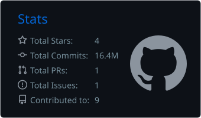
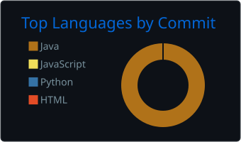
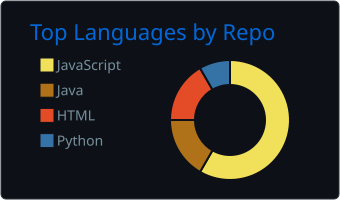
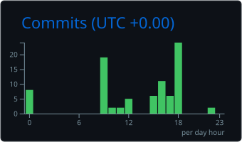

<div align="center">


<a href="https://github.com/Jyrrel">
  
</a>

<br/><br/>


</div>

---

## 👾 whoami

```bash
jyrrel@bsit:~$ whoami
> Jyrrel James N. Estrada | 3rd-year BSIT student @ PHINMA COC

jyrrel@bsit:~$ cat skills.txt
> JavaScript · PHP · Python · Java · C · Next.js · MySQL

jyrrel@bsit:~$ cat currently.txt
> learning Node.js + React.js | building school systems

jyrrel@bsit:~$ echo $HOBBIES
> gaming 🎮 | coding 💻 | manhwa 📖 | sleeping 💤

jyrrel@bsit:~$ ./contact --email Estrada.jyrrel789@gmail.com
> ready to collaborate. let's build something cool.
```

<div align="center">
  
</div>

---

## 🛠️ Tech Stack

<div align="center">

**Languages**<br/>


**Frameworks & Runtime**<br/>


**Databases**<br/>


**Tools**<br/>


</div>

---

## 🚀 Featured Projects

| Project | Tech | What it does |
| :-- | :-- | :-- |
| 🛒 **[Sari-Sari Store POS](https://github.com/Jyrrel?tab=repositories)** | JavaScript | Point-of-sale with a 50-product catalog and cart-style multi-item checkout |
| 🏷️ **[Price Verification Tool](https://github.com/Jyrrel?tab=repositories)** | HTML, JS, Axios, PHP | Scan or search a product and get its price from a PHP API |
| 🏥 **[Patient Record System](https://github.com/Jyrrel?tab=repositories)** | Database design | Users, doctors, patients, appointments and consultations |
| 🏘️ **[Barangay Website](https://github.com/Jyrrel?tab=repositories)** | Web | A website for a local barangay |

<div align="right"><a href="https://github.com/Jyrrel?tab=repositories">See all repositories →</a></div>

---

## 📈 Stats

<div align="center">







</div>

---

## 🐍 Contribution Snake

<div align="center">
  
</div>

---

## 🌐 Let's Connect

<div align="center">

<a href="https://github.com/Jyrrel"></a>
<a href="https://www.linkedin.com/in/jyrrel-estrada-0a3a65337/"></a>
<a href="https://m.facebook.com/Jyrrel1"></a>
<a href="https://open.spotify.com/user/31l24dpfeszebysvkjbcqpsiksoy"></a>
<a href="mailto:Estrada.jyrrel789@gmail.com"></a>

<br/><br/>

**Thanks for stopping by! If you liked what you saw, drop a ⭐**


</div>
